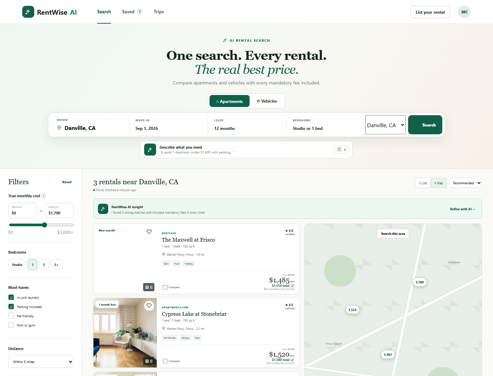
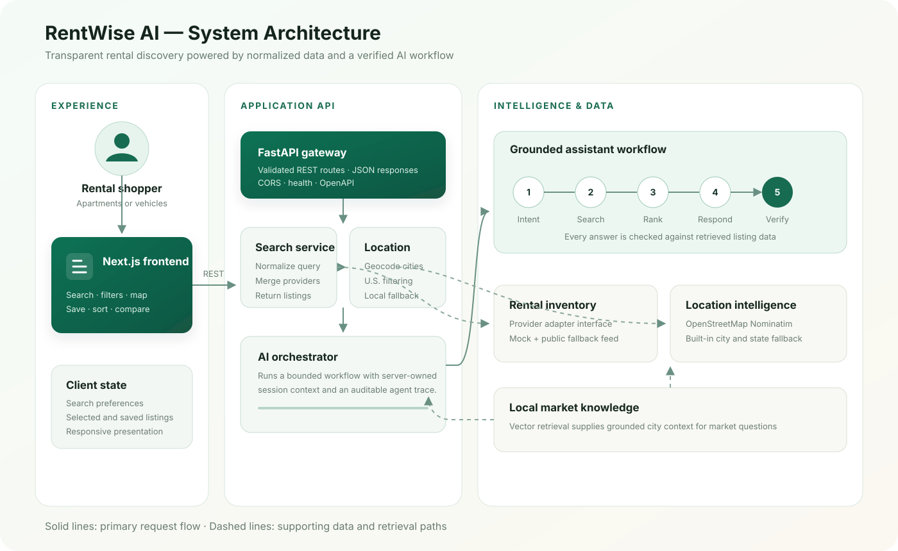

<div align="center">

# RentWise AI

### One search. Every rental. The real best price.

An AI-assisted rental marketplace that compares apartments and vehicles by their complete cost—not just the advertised price.

[](https://nextjs.org/)
[](https://react.dev/)
[](https://fastapi.tiangolo.com/)
[](https://www.typescriptlang.org/)
[](#quality-checks)

</div>



## Why RentWise?

Rental prices are rarely the final prices. RentWise brings apartments and vehicles into one search experience, normalizes their costs, includes known mandatory fees, and uses a grounded AI workflow to help users find and compare the strongest options.

| Search smarter | Compare honestly | Decide confidently |
| --- | --- | --- |
| Search by location or describe a rental in natural language. | See recurring fees and true totals alongside advertised prices. | Save, rank, map, and compare up to three rentals side by side. |

## Product highlights

- **Two rental modes** — search apartments and rental vehicles from one interface
- **True-cost pricing** — expose known mandatory fees and complete rental totals
- **AI-assisted discovery** — translate natural-language requests into structured requirements
- **Grounded recommendations** — rank retrieved listings and verify generated prices and citations
- **Location intelligence** — use OpenStreetMap geocoding with resilient local fallbacks
- **Interactive exploration** — filter, sort, save, compare, and switch between list and map views
- **Provider-ready backend** — add licensed inventory sources through a clean adapter interface
- **Graceful degradation** — remain demo-ready with local listings and a no-key public market feed

## System architecture



### Request flow

1. The Next.js client sends structured search requests or conversational prompts to FastAPI.
2. Standard searches are normalized by the search service and dispatched to provider adapters.
3. Conversational searches pass through a bounded pipeline: intent extraction, retrieval, ranking, response generation, and verification.
4. The verification agent checks generated claims against retrieved listings before returning the answer.
5. Market questions can use local vector retrieval, while location queries use OpenStreetMap with a built-in fallback.

## Technology

| Area | Stack |
| --- | --- |
| Web | Next.js 16, React 19, TypeScript, responsive CSS |
| API | FastAPI, Uvicorn, Pydantic, HTTPX |
| Intelligence | Multi-agent orchestration, local RAG, vector retrieval |
| Integrations | OpenStreetMap Nominatim, provider adapters, public fallback feed |
| Quality | Pytest, TypeScript compiler, Next.js production build |
| Infrastructure | Docker Compose, optional PostgreSQL 16 |

## Repository layout

```text
rental-searching-app/
├── frontend/
│   ├── app/                    # Next.js page, layout, and UI styles
│   └── public/                 # Static product assets
├── backend/
│   ├── app/
│   │   ├── agents/             # Intent → search → rank → respond → verify
│   │   ├── providers/          # Rental inventory adapters
│   │   ├── services/           # Search orchestration
│   │   ├── ai_stack.py         # Local retrieval pipeline
│   │   └── main.py             # FastAPI application and routes
│   └── tests/                  # API and AI behavior tests
├── agentic/                    # Standalone RAG and graph patterns
├── docs/assets/                # README product imagery
├── docker-compose.yml          # Optional PostgreSQL service
└── package.json                # Full-stack developer commands
```

## Getting started

### Prerequisites

- Node.js 20+
- Python 3.11+

### Installation

```powershell
git clone https://github.com/ManeeshChintalapudi12/rental-searching-agent.git
cd rental-searching-agent

npm install
npm --prefix frontend install

python -m venv .venv
.venv\Scripts\python.exe -m pip install -r backend\requirements.txt
Copy-Item .env.example .env
```

No paid rental API key is required for the included development experience.

### Run the full stack

```powershell
npm run dev
```

| Service | URL |
| --- | --- |
| Web application | <http://localhost:3000> |
| API | <http://127.0.0.1:8000> |
| OpenAPI documentation | <http://127.0.0.1:8000/docs> |

To connect the frontend to a separately hosted API:

```env
NEXT_PUBLIC_API_URL=https://your-api.example.com
```

## API overview

| Method | Route | Description |
| --- | --- | --- |
| `GET` | `/health` | Check API health and version |
| `GET` | `/api/location-search` | Resolve a U.S. location |
| `GET` | `/api/public-rentals` | Retrieve fallback market listings |
| `GET` | `/api/ai/rag` | Ask a market-context question |
| `GET` | `/api/live-feed` | Stream a sample market pulse |
| `POST` | `/api/v1/search` | Run a structured rental search |
| `POST` | `/api/v1/chat` | Run the grounded assistant workflow |
| `GET` | `/api/v1/listings/{id}` | Retrieve normalized listing details |

Example:

```powershell
Invoke-RestMethod "http://127.0.0.1:8000/api/location-search?query=Danville,CA"
```

## Quality checks

```powershell
# Optimized frontend build + TypeScript validation
npm run build

# Backend API and AI tests
.venv\Scripts\python.exe -m pytest -q backend\tests
```

Current verification:

- Next.js production build: **passing**
- TypeScript validation: **passing**
- Backend test suite: **9 passing**

## Deployment

### Frontend

Deploy the `frontend/` directory to Vercel and set `NEXT_PUBLIC_API_URL` to the public FastAPI URL.

### Backend

Install `backend/requirements.txt` and start the application from the backend directory:

```powershell
uvicorn app.main:app --host 0.0.0.0 --port 8000
```

### Optional database

```powershell
docker compose up --build
```

This starts the included PostgreSQL 16 service. The current demo flow does not require it.

## Production roadmap

- Connect licensed apartment and vehicle inventory providers
- Persist users, searches, favorites, and comparisons in PostgreSQL
- Add authentication and provider credential management
- Replace the illustrative map with a production mapping SDK
- Add observability, rate limits, caching, and integration tests

## Data disclaimer

The bundled mock provider and public fallback feed are intended for development and portfolio demonstrations. Production use requires licensed, real-time inventory and pricing sources.

<div align="center">

Built as a practical full-stack demonstration of transparent rental search and grounded AI.

</div>
