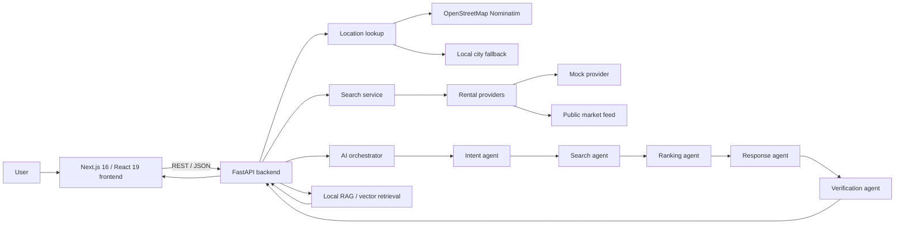

# RentWise AI

RentWise AI is a full-stack rental discovery experience for comparing apartments and vehicles by their true total cost. It combines a polished Next.js interface with a FastAPI API and a bounded, explainable AI workflow for intent extraction, search, ranking, response generation, and verification.


## Features

- Search apartments and rental vehicles by U.S. city and state
- Compare prices with mandatory fees included
- Switch between list and map views, save listings, and compare up to three rentals
- Refine searches using natural-language requests
- Resolve locations with OpenStreetMap Nominatim and a local fallback
- Use a no-key public market feed when paid provider APIs are unavailable
- Ground AI responses in retrieved listings and verify prices and citations

## Architecture



The frontend calls the FastAPI service through `NEXT_PUBLIC_API_URL`. Standard searches use the search service and provider adapters. Conversational searches follow the bounded agent pipeline, while the local RAG layer supplies market context. Location lookup falls back to built-in city data when OpenStreetMap is unavailable.

## Tech stack

| Layer | Technology |
| --- | --- |
| Frontend | Next.js 16, React 19, TypeScript, CSS |
| Backend | FastAPI, Uvicorn, Pydantic, HTTPX |
| AI | Agent orchestration, local RAG, vector retrieval |
| Data | OpenStreetMap Nominatim, public fallback feed, provider adapters |
| Testing | Pytest |

## Project structure

```text
rental-searching-app/
|-- frontend/               # Next.js user interface
|   |-- app/                # App Router pages and styles
|   `-- public/             # Static assets
|-- backend/                # FastAPI service
|   |-- app/agents/         # Bounded AI agent workflow
|   |-- app/providers/      # Rental data adapters
|   |-- app/services/       # Search orchestration
|   `-- tests/              # API and AI tests
|-- agentic/                # Standalone RAG and graph patterns
|-- docker-compose.yml      # Optional PostgreSQL service
|-- package.json            # Root development commands
`-- README.md
```

## Run locally

### Prerequisites

- Node.js 20 or newer
- Python 3.11 or newer

### 1. Install dependencies

```powershell
npm install
npm --prefix frontend install
python -m venv .venv
.venv\Scripts\python.exe -m pip install -r backend\requirements.txt
```

### 2. Configure the environment

```powershell
Copy-Item .env.example .env
```

The application works without a paid rental API key. To use a separately deployed backend, set:

```env
NEXT_PUBLIC_API_URL=https://your-backend.example.com
```

### 3. Start the full stack

```powershell
npm run dev
```

- Frontend: <http://localhost:3000>
- Backend: <http://127.0.0.1:8000>
- Interactive API docs: <http://127.0.0.1:8000/docs>

## Build and test

```powershell
npm run build
.venv\Scripts\python.exe -m pytest -q backend\tests
```

Check the running API:

```powershell
Invoke-RestMethod http://127.0.0.1:8000/health
```

## Main API endpoints

| Method | Endpoint | Purpose |
| --- | --- | --- |
| `GET` | `/health` | Service health check |
| `GET` | `/api/location-search?query=Danville,CA` | U.S. location lookup |
| `GET` | `/api/public-rentals?city=Danville&state=CA&limit=5` | Public fallback listings |
| `GET` | `/api/ai/rag?question=...` | Local market-context retrieval |
| `POST` | `/api/v1/search` | Structured rental search |
| `POST` | `/api/v1/chat` | Agent-assisted rental search |
| `GET` | `/api/v1/listings/{listing_id}` | Listing details |

## Deployment

Deploy `frontend/` to Vercel and configure `NEXT_PUBLIC_API_URL` with the public backend URL. Deploy `backend/` to a Python host such as Render or Railway with this start command:

```powershell
uvicorn app.main:app --host 0.0.0.0 --port 8000
```

The included Docker Compose file starts the optional PostgreSQL 16 service:

```powershell
docker compose up --build
```

## Data note

The current public feed and mock provider are suitable for development and portfolio demonstrations. They are not a substitute for a licensed, real-time rental inventory provider in production.
